# Step-by-Step Implementation — Screenshots

All screenshots were captured from real runs of the project (A1–A9 on 10 November 2026; A10–A14 and
all GUI screens B1–B18 on 18 November 2026, after the GUI rework), on Windows 11 with a Python 3.12 virtual
environment, on a white background. The Python steps use
[`screenshots/sample_input.py`](screenshots/sample_input.py): a small Flask module with a loop,
a raised exception, a SQL query built by string concatenation, and a class with an unused
local variable. The Java, C and C++ steps use the sample files in `tests/inputs/multilang/`
(`Inventory.java`, `shapes.cpp`, `matrix.c`).

## Part A — Command line

| Step | Screenshot | What it shows |
|---|---|---|
| A1 | 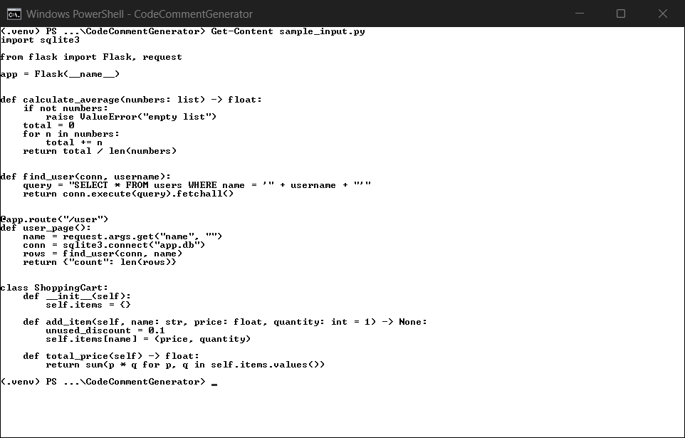 | The input file to be documented. |
| A2 |  | Rule-based run: 6 functions and 1 class found, 8 comments generated, IR built for 6 functions, 1 analysis finding, 1 security finding. |
| A3 |  | Annotated output (rule-based): block comment plus a Google-style docstring with Args / Returns / Raises taken from the AST. |
| A4 |  | Same file with the neuro-symbolic engine (T5 model + rules). |
| A5 |  | Neuro-symbolic output: ML summary *"Calculate the average of numbers."* used in *fused* mode (ML confidence 46 %), structured sections still from the AST. |
| A6 | 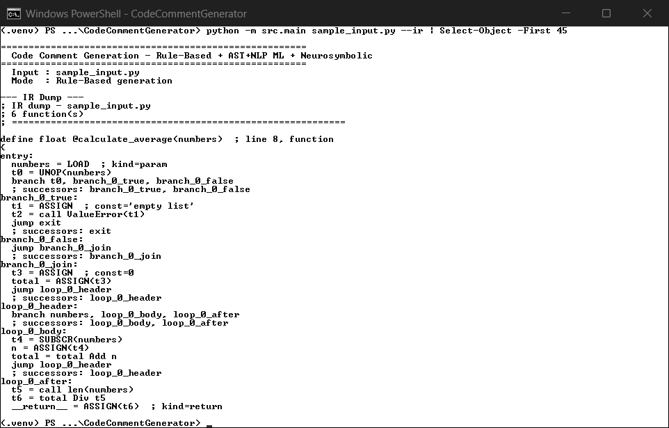 | Intermediate representation: three-address instructions in basic blocks (`entry`, `branch_0_true`, `loop_0_header`, …) with explicit successors. |
| A7 |  | Data-flow pattern analysis: P001 — `unused_discount` is assigned but never read. |
| A8 |  | Security scan: SQL injection (SEC005, CWE-89) with the full source-to-sink trace across two functions and a fix suggestion. |
| A9 |  | Security evaluation on the labelled fixtures: precision, recall, F1 and false-positive rate. |
| A10 | 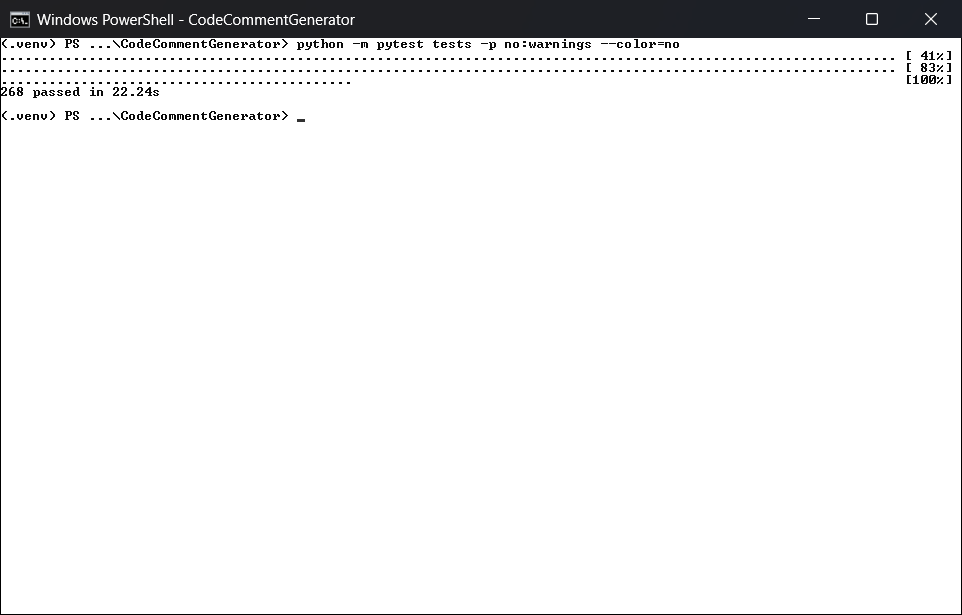 | Automated test suite: 268 tests passed. |
| A11 | 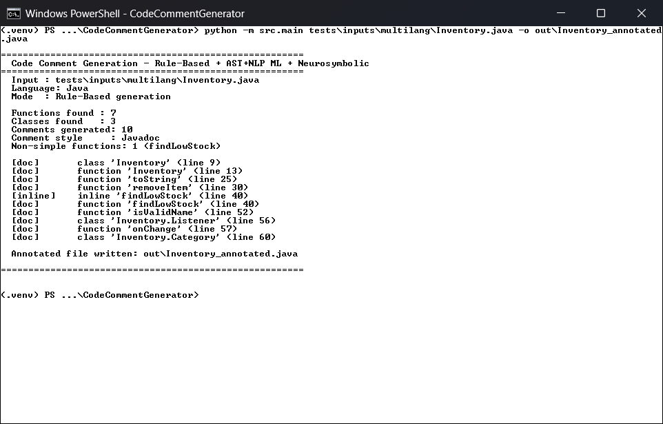 | Java input (`tests/inputs/multilang/Inventory.java`): language detected from the extension, 7 methods and 3 classes found, 10 Javadoc comments generated. |
| A12 | 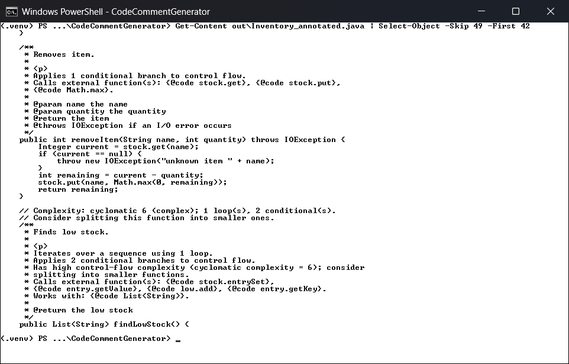 | Annotated Java: Javadoc with `@param`, `@return`, `@throws IOException`, generic types inside `{@code …}`, and a complexity note above the complex method. |
| A13 |  | Annotated C++ (`shapes.cpp`): Doxygen comments for a constructor that throws `std::invalid_argument`, a method, and a template function with a default argument. |
| A14 |  | The annotated Java, C++ and C files still compile with `javac`, `g++` and `gcc`. |

## Part B — Desktop GUI (`python run_gui.py`)

| Step | Screenshot | What it shows |
|---|---|---|
| B1 | 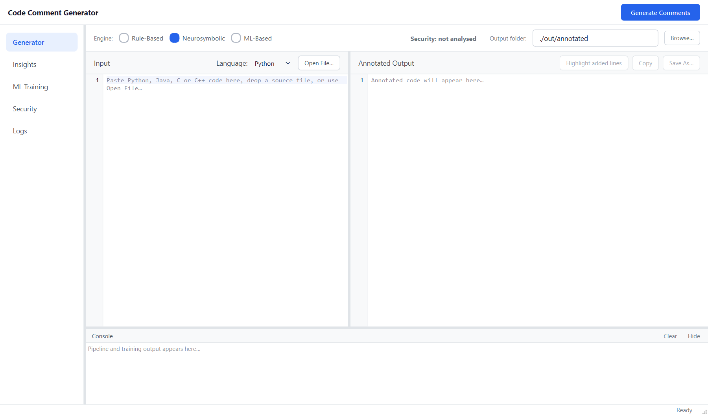 | Start screen: Generator, Insights, ML Training, Security and Logs workspaces; engine choice, Language box and output folder at the top. |
| B2 |  | `sample_input.py` opened (Language: Python), neuro-symbolic engine selected. |
| B3 |  | After *Generate Comments*: annotated output beside the input with added lines highlighted (8 comments, 85 lines added); the badge shows 16.7 % unsafe, 1 issue. |
| B4 | 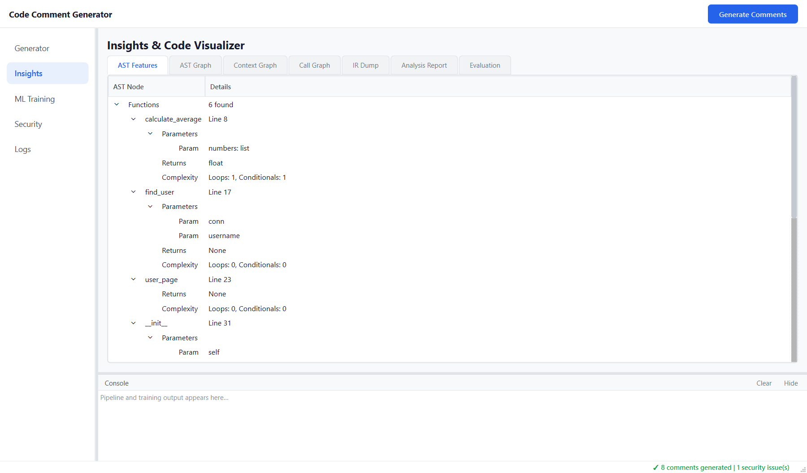 | Insights → AST Features: functions, parameters, types and complexity as a tree. |
| B5 | 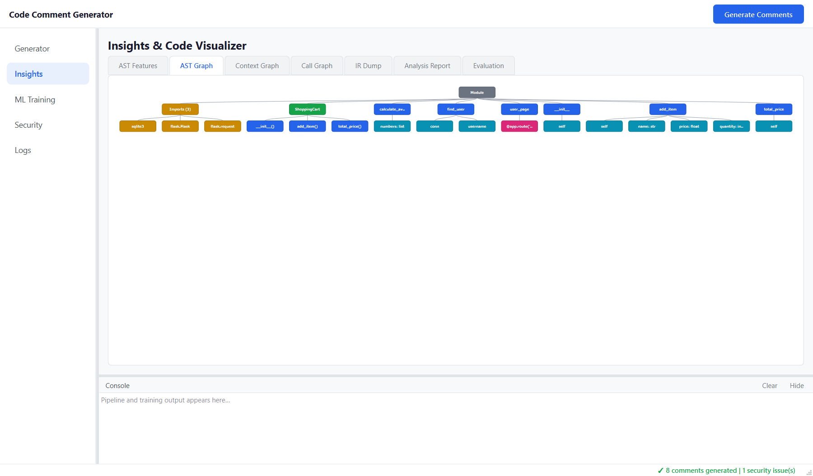 | Insights → AST Graph: module, imports, classes, functions and parameters (the graph fits itself to the window). |
| B6 |  | Insights → Context Graph: complexity and variables per function. |
| B7 | 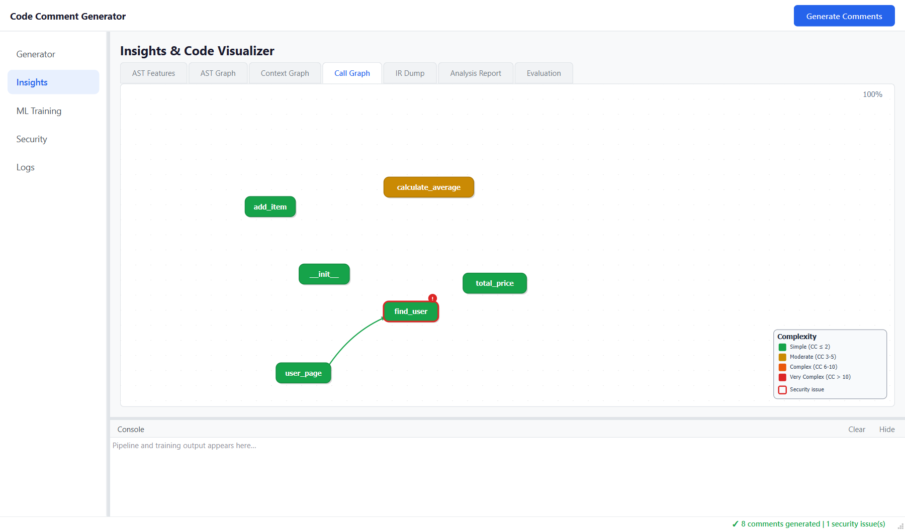 | Insights → Call Graph: `user_page` calls `find_user`; nodes coloured by complexity, red border marks the security issue. |
| B8 |  | Insights → IR Dump. |
| B9 | 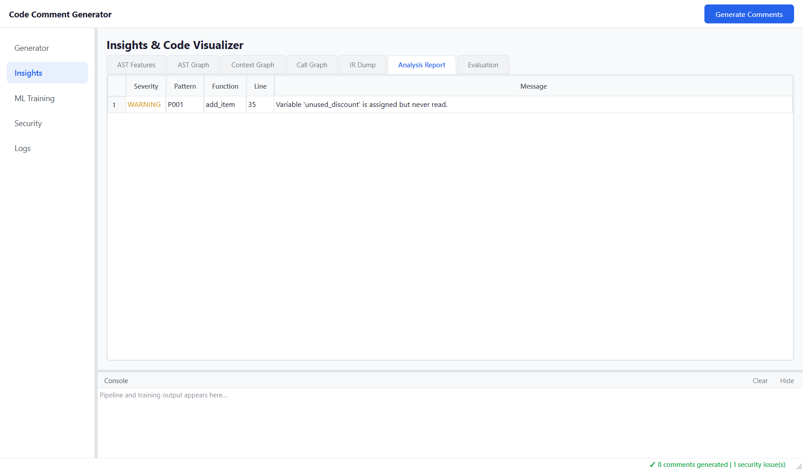 | Insights → Analysis Report (P001–P007 findings). |
| B10 |  | Insights → Evaluation: training-loss curve, BLEU-4 / ROUGE-L / exact-match bars, confidence-vs-quality scatter. |
| B11 | 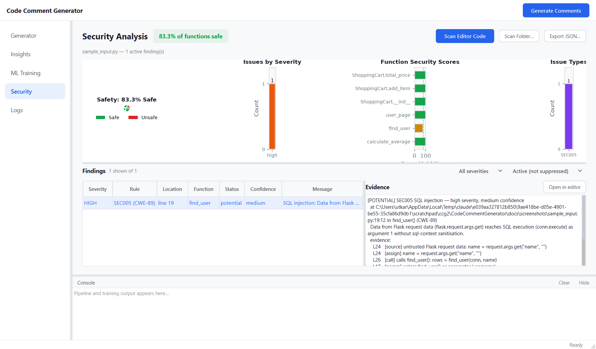 | Security workspace: `find_user` scores 75 because of the SQL injection, so the module is 83.3 % safe / 16.7 % unsafe; charts and the findings table. |
| B12 |  | ML Training workspace: presets and options, Start / Cancel, and the model card of the recorded training run (13,480 pairs, 3 epochs; BLEU-4 0.060, ROUGE-L 0.262, exact match 1 %). |
| B13 |  | Logs workspace: output files and a JSON report viewer. |
| B14 | 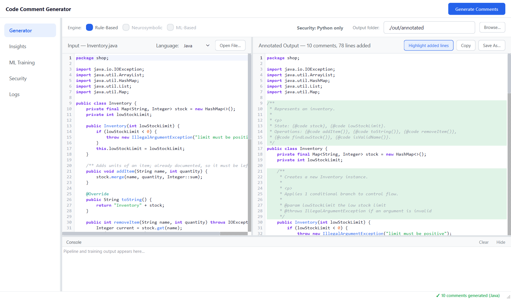 | A Java file opened: the *Language* box switches to Java, the ML engines are disabled (the model is Python-only), and Javadoc is generated. |
| B15 | 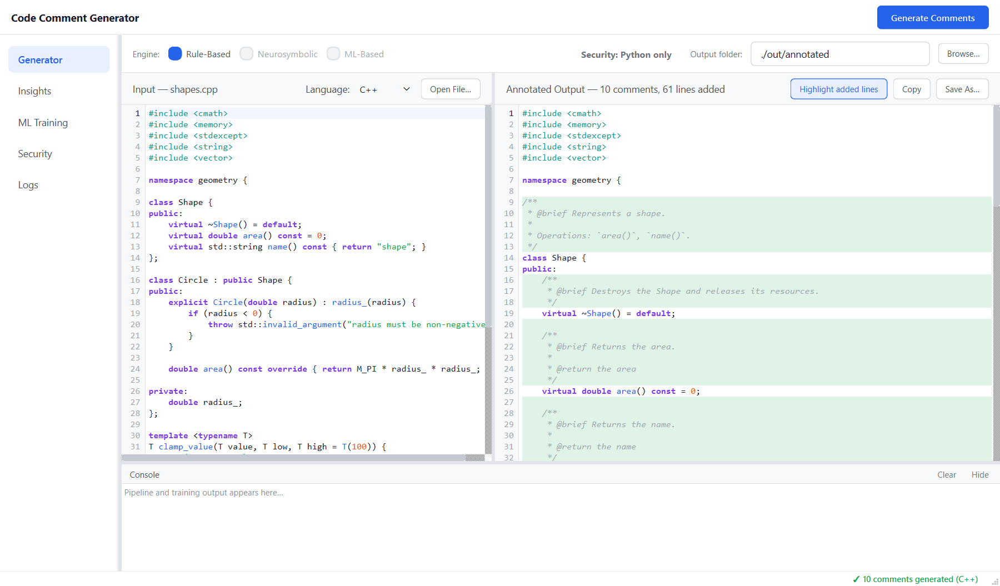 | A C++ file: Doxygen comments for the class, destructor and methods, with C++ syntax highlighting. |
| B16 |  | Insights → AST Graph for the C++ file: includes, classes, methods, functions and parameters. |
| B17 |  | Insights → Call Graph for the Java file, coloured by cyclomatic complexity (`findLowStock` is complex). |
| B18 |  | Security workspace for a C++ file: clearly marked "Not scanned (Python only)" instead of a misleading score. |

Notes on how the screenshots were taken:
- Console screenshots: the commands were run in a Windows console set to a white background;
  the console's light-grey background was converted to pure white afterwards.
- GUI screenshots: the real application window was driven by a script (file loaded, engine
  selected, button pressed, tabs opened) and each screen saved with Qt's own window capture.
  B12 shows the model card the workspace reads from the recorded training run
  (`outputs/training_report.json`, `outputs/eval_report.json`); training was not re-run for
  the screenshot.
