# Step-by-Step Implementation — Screenshots

All screenshots were captured from real runs of the project on 10 November 2026 (Windows 11,
Python 3.12 virtual environment), on a white background. The input used throughout is
[`screenshots/sample_input.py`](screenshots/sample_input.py): a small Flask module with a loop,
a raised exception, a SQL query built by string concatenation, and a class with an unused
local variable.

## Part A — Command line

| Step | Screenshot | What it shows |
|---|---|---|
| A1 |  | The input file to be documented. |
| A2 | 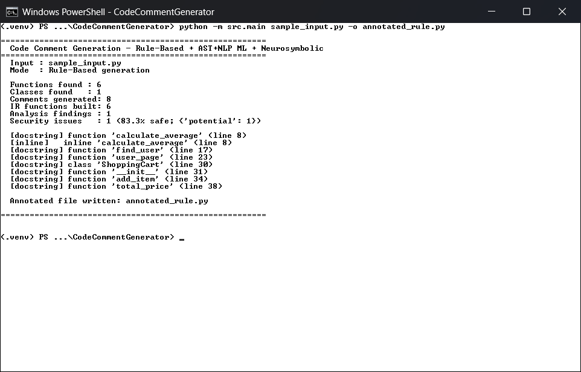 | Rule-based run: 6 functions and 1 class found, 8 comments generated, IR built for 6 functions, 1 analysis finding, 1 security finding. |
| A3 | 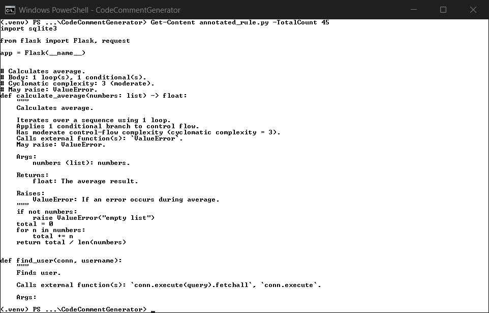 | Annotated output (rule-based): block comment plus a Google-style docstring with Args / Returns / Raises taken from the AST. |
| A4 | 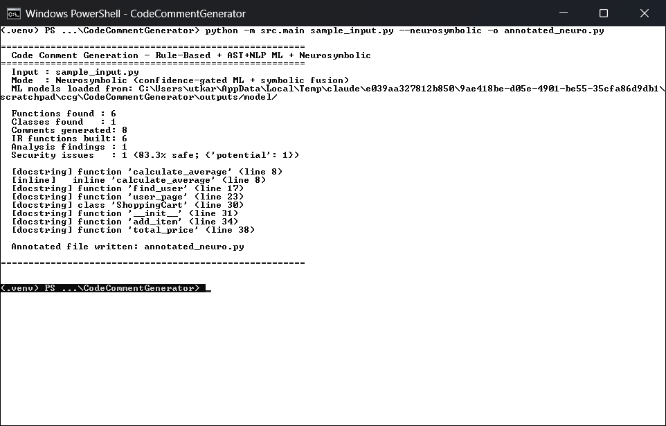 | Same file with the neuro-symbolic engine (T5 model + rules). |
| A5 | 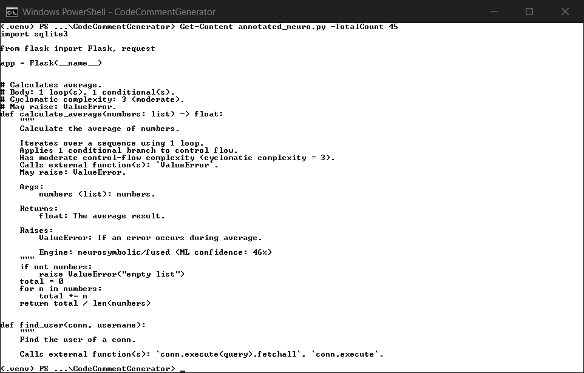 | Neuro-symbolic output: ML summary *"Calculate the average of numbers."* used in *fused* mode (ML confidence 46 %), structured sections still from the AST. |
| A6 |  | Intermediate representation: three-address instructions in basic blocks (`entry`, `branch_0_true`, `loop_0_header`, …) with explicit successors. |
| A7 | 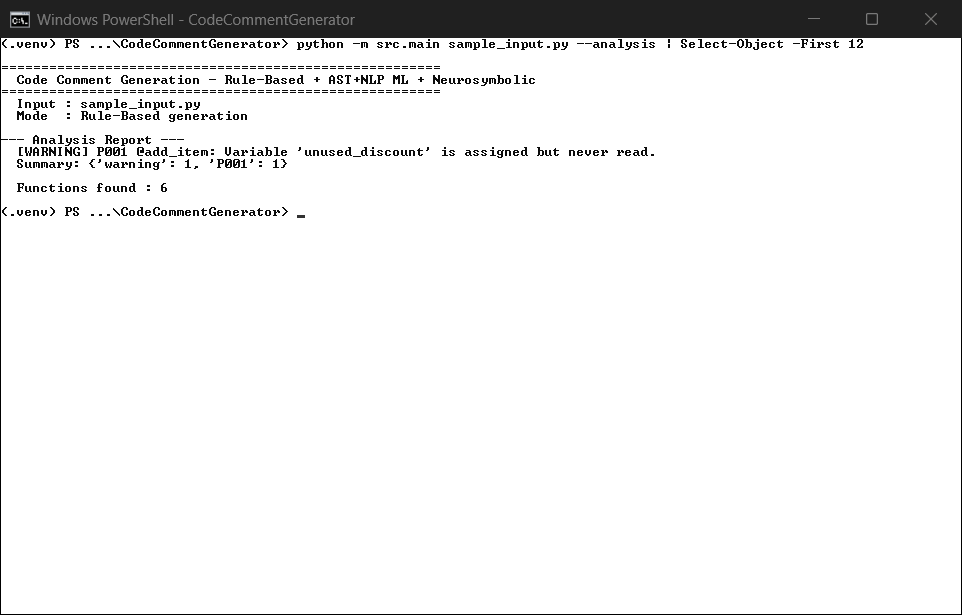 | Data-flow pattern analysis: P001 — `unused_discount` is assigned but never read. |
| A8 | 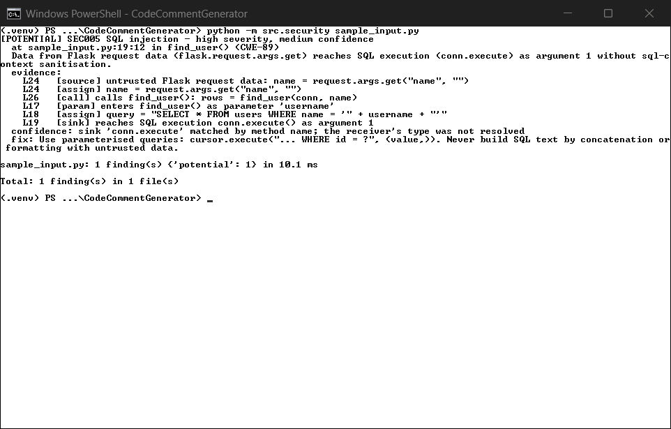 | Security scan: SQL injection (SEC005, CWE-89) with the full source-to-sink trace across two functions and a fix suggestion. |
| A9 | 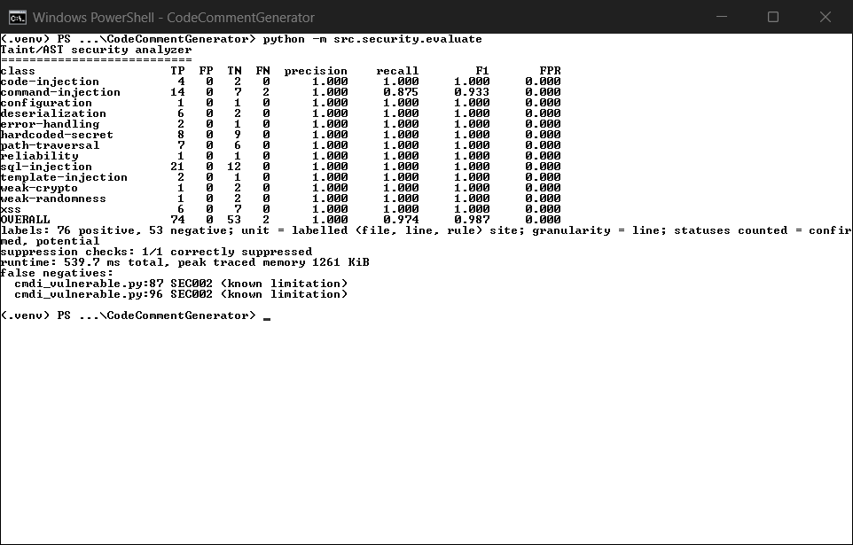 | Security evaluation on the labelled fixtures: precision, recall, F1 and false-positive rate. |
| A10 |  | Automated test suite: 229 tests passed. |

## Part B — Desktop GUI (`python run_gui.py`)

| Step | Screenshot | What it shows |
|---|---|---|
| B1 |  | Start screen with the five workspaces. |
| B2 | 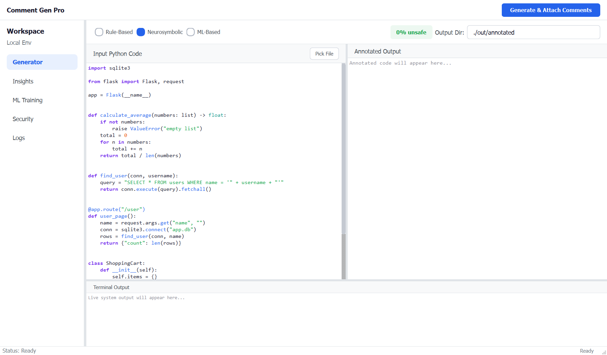 | Input file loaded, neuro-symbolic engine selected. |
| B3 | 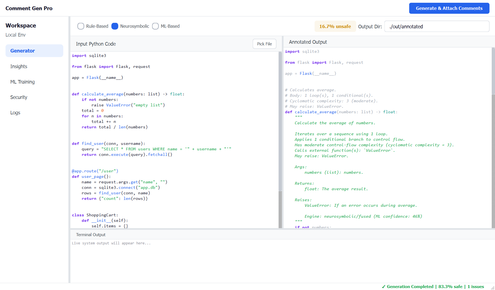 | After *Generate & Attach Comments*: annotated output beside the input. |
| B4 |  | Insights → AST Features: functions, parameters, types and complexity as a tree. |
| B5 |  | Insights → AST Graph: module, imports, classes, functions and parameters (the graph fits itself to the window). |
| B6 | 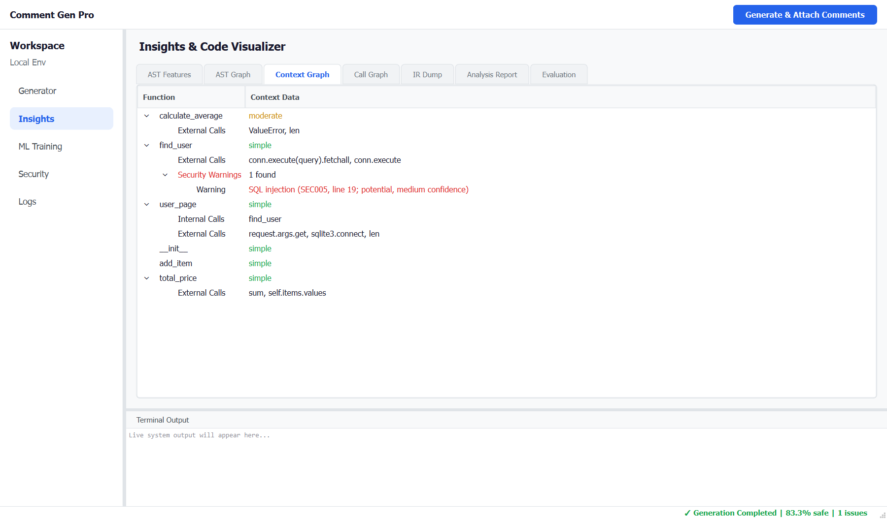 | Insights → Context Graph: complexity and variables per function. |
| B7 |  | Insights → Call Graph: `user_page` calls `find_user`; nodes coloured by complexity, red border marks the security issue. |
| B8 | 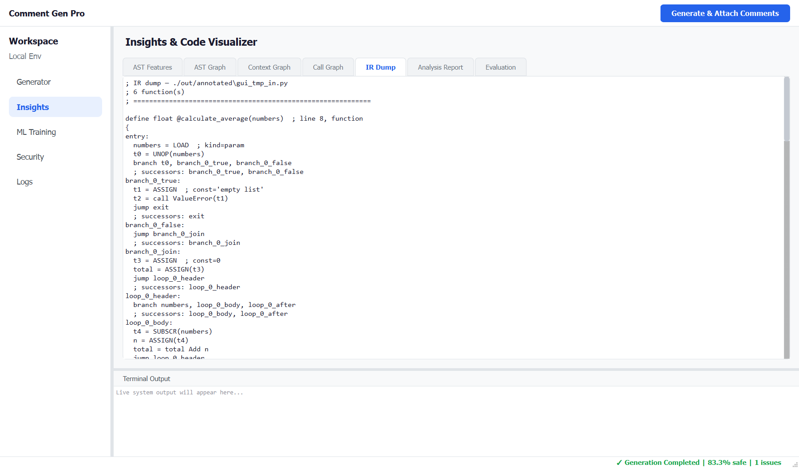 | Insights → IR Dump. |
| B9 |  | Insights → Analysis Report (P001–P007 findings). |
| B10 | 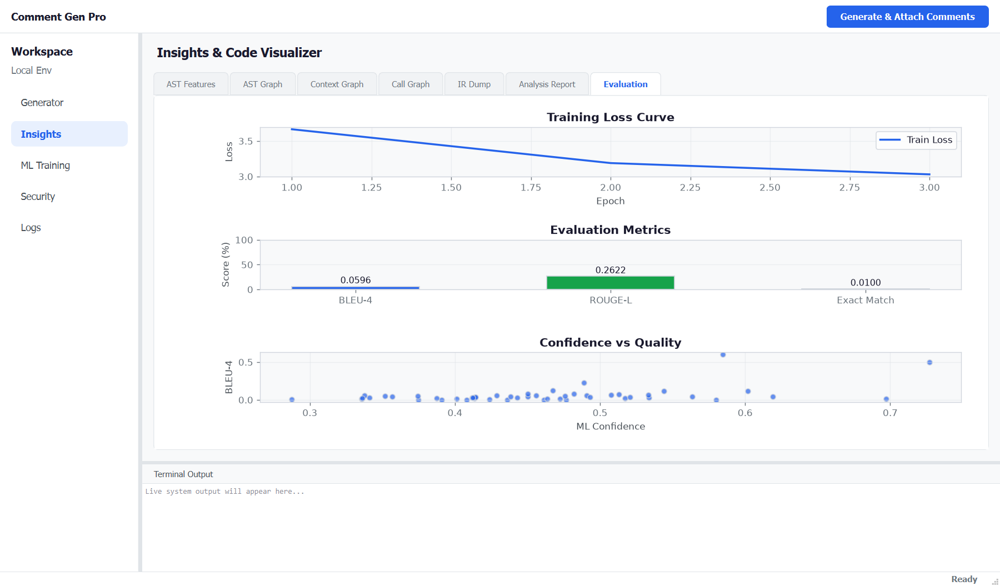 | Insights → Evaluation: training-loss curve, BLEU-4 / ROUGE-L / exact-match bars, confidence-vs-quality scatter. |
| B11 |  | Security workspace: `find_user` scores 75 because of the SQL injection, so the module is 83.3 % safe / 16.7 % unsafe; charts and the findings table. |
| B12 | 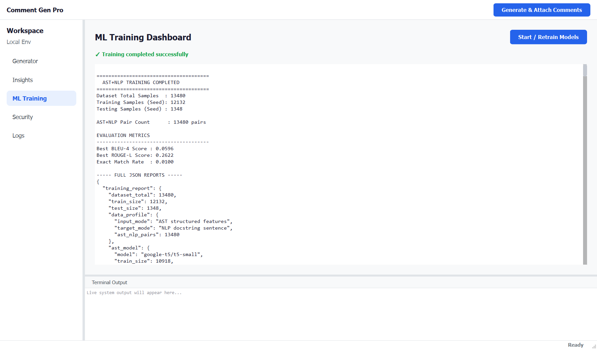 | ML Training workspace showing the report of the recorded training run (13,480 pairs; BLEU-4 0.0596, ROUGE-L 0.2622). |
| B13 | 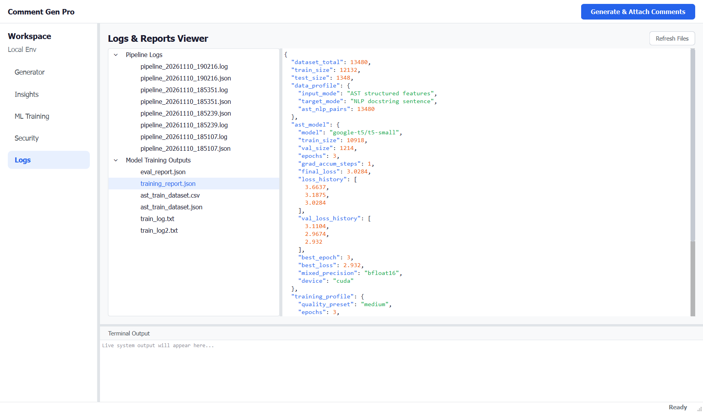 | Logs workspace: output files and a JSON report viewer. |

Notes on how the screenshots were taken:
- Console screenshots: the commands were run in a Windows console set to a white background;
  the console's light-grey background was converted to pure white afterwards.
- GUI screenshots: the real application window was driven by a script (file loaded, engine
  selected, button pressed, tabs opened) and each screen saved with Qt's own window capture.
  For B12 the GUI's training-finished view was given the saved reports from the recorded
  training run (`outputs/training_report.json`, `outputs/eval_report.json`), which is exactly
  what it displays after training; training was not re-run for the screenshot.
